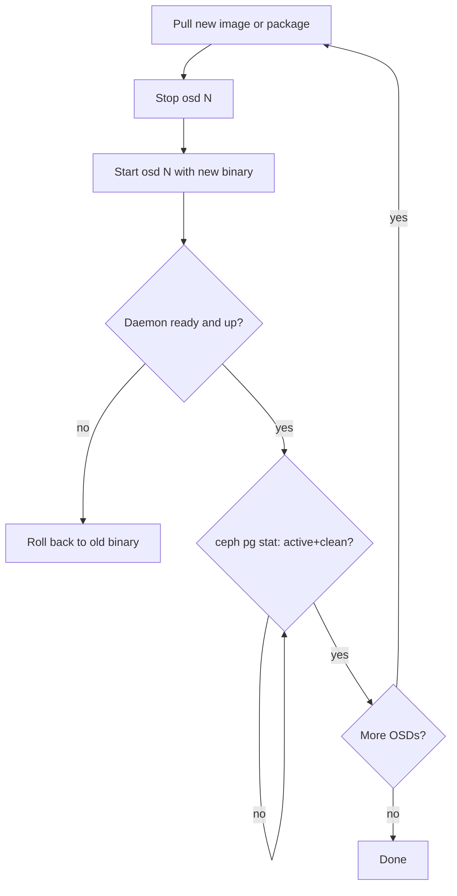

# How to upgrade croit-flashstore-osd without client errors

Upgrade one OSD at a time and wait for the cluster to return to `active+clean` between steps.

## Preconditions

- Pools that hold data on croit-flashstore-osd have size >= 2 and min_size <= size - 1. With these settings, clients see no errors while one OSD restarts.
- The new version supports the same `require_osd_release` as the cluster. A too-new cluster refuses the daemon with exit 3 (see [reference/exit-codes.md](../reference/exit-codes.md)).
- For `require-osd-release` raises, upgrade all croit-flashstore-osd OSDs first.

## Procedure

For each croit-flashstore-osd OSD `N`, one at a time:



```
systemctl stop croit-flashstore-osd@N
# install the new binary, or set the new image tag
systemctl start croit-flashstore-osd@N
ceph osd tree | grep "osd.N "
ceph pg stat
```

Wait for `active+clean` before the next OSD. Rollback is the old binary with the same steps (`ceph osd set noout` first),
as long as the newer build has not enabled a store feature the old one does not know (an offline `croit-flashstore-tool upgrade`
step, or a feature set at first use). Then the old binary refuses the store at start (exit 78, "downgrade not possible
after [..] was enabled") and never reads it: start the newer binary again.

## Verify

```
ceph tell osd.N status
ceph versions
```

`ceph versions` should show the new version for the upgraded OSD only until the rolling pass finishes.

## Recovery if an upgrade stalls

If a PG stays `peering` or `incomplete` after restart, check [how-to/recover-pg.md](recover-pg.md) before taking any further action. Do not stop a second OSD while the first is not clean.
